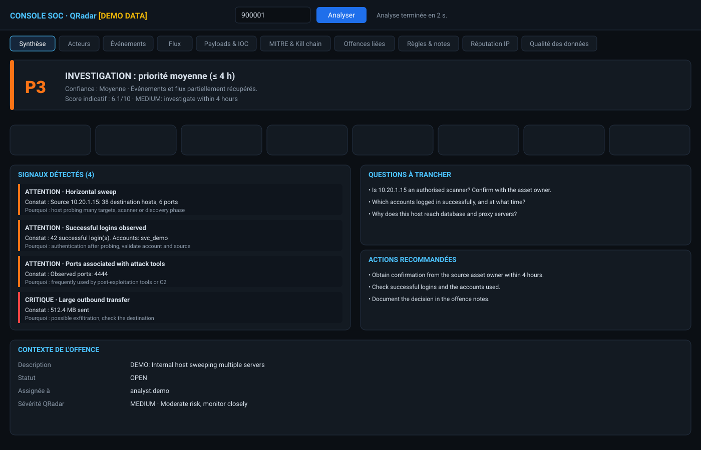
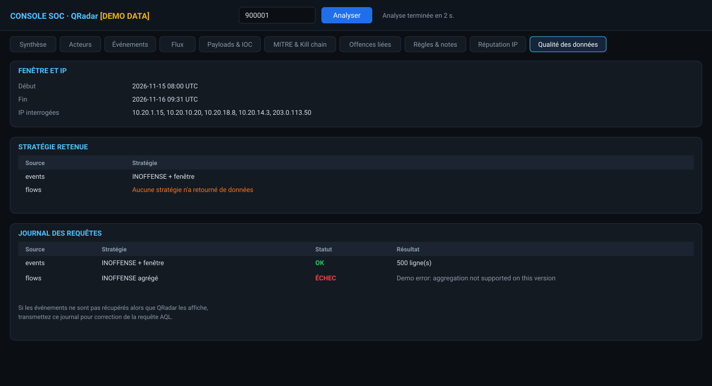

# ShadowTrace — QRadar Offence Investigation Console

**ShadowTrace** is a SOC investigation console designed to simplify and accelerate IBM QRadar offence analysis.

By providing a QRadar offence ID, analysts can explore correlated events, network flows, involved assets, indicators of compromise (IOCs), threat intelligence, and MITRE ATT&CK mappings through a unified web interface.

ShadowTrace also provides explainable investigation signals, indicative P2–P5 prioritization, confidence levels, and recommended investigation actions to support analyst decision-making.

> **Project status:** Work in progress. ShadowTrace is designed to assist SOC analysts, not replace human investigation or incident-response decisions.

## Screenshots

### Investigation overview


### Data collection and query diagnostics


## Key Features

| Module | Description |
|---|---|
| **Synthesis** | Indicative P2–P5 prioritization, confidence level, investigation KPIs, evidence-based signals, open questions, and recommended actions. |
| **Actors** | Source and destination hosts, network zones, and available asset information. |
| **Events** | Event categories, destination ports, suspicious ports, horizontal and port scans, successful logins, and event timelines. |
| **Flows** | Aggregated traffic volumes by source, destination, and port; protocol distribution and large outbound transfer detection. |
| **Payloads & IOCs** | Extraction of IP addresses, URLs, hashes, CVEs, JWTs, credential-related keywords, Base64 decoding, and suspicious commands. |
| **MITRE ATT&CK & Kill Chain** | Potential ATT&CK technique mapping and Cyber Kill Chain stage identification based on available evidence. |
| **Related Offences** | Identification of QRadar offences sharing addresses or categories with the investigated offence. |
| **Rules & Notes** | Triggered QRadar rules, including disabled rules, and analyst investigation notes. |
| **IP Reputation** | IP repetition analysis within QRadar over the previous 30 days and optional external threat-intelligence lookups. |
| **Data Quality** | Query execution logs, data-source status, time windows, resolved IP addresses, and collection diagnostics. |

Investigation results can be exported as JSON or printed for documentation and reporting.

## Architecture

```text
                 SOC Analyst
                      |
                      v
              Web Investigation Console
                      |
                GET /api/offence/<id>
                      |
                      v
                 Flask Application
                    (app.py)
                      |
          +-----------+-----------+
          |           |           |
          v           v           v
      decision.py  collector.py  ti.py
      analyzer.py      |           |
          |            |           |
          |            v           |
          |       QRadar REST API  |
          |          + AQL         |
          |            |           |
          +------------+-----------+
                       |
                       v
              Investigation Results
                       |
          +------------+-------------+
          |                          |
          v                          v
    SOC Investigation          Optional CTI
    Signals & Analysis         Enrichment
                               |
                       +-------+-------+
                       |       |       |
                       v       v       v
                    AbuseIPDB VirusTotal OTX
```

### Main Components

- **app.py:** Flask web application and API endpoints.
- **decision.py:** Investigation prioritization and confidence assessment.
- **analyzer.py:** Evidence analysis, IOC extraction, MITRE ATT&CK mapping, and Kill Chain identification.
- **collector.py:** QRadar AQL queries, fallback strategies, and data-quality logging.
- **ti.py:** IP repetition analysis and optional threat-intelligence enrichment.

### Data Sources

**IBM QRadar**
- Offences
- Events
- Network flows
- Correlation rules
- Assets and related information

**Optional external threat-intelligence services**
- AbuseIPDB
- VirusTotal
- AlienVault OTX

External reputation lookups are optional and are restricted to public IP addresses.

## Requirements

- Python 3.11
- Access to an IBM QRadar deployment.
- A QRadar API token with the required read-only permissions.
- Network connectivity between the ShadowTrace server and QRadar.
- Optional API keys for external threat-intelligence services.

QRadar AQL fields and query behaviour may vary depending on the deployed version.

## Installation

Clone the repository:

```bash
git clone https://github.com/SHADOS-ISC/ShadowTrace-Automated-SIEM-Investigation-Engine.git

cd ShadowTrace-Automated-SIEM-Investigation-Engine
```

Create and activate a virtual environment:

```bash
python3.11 -m venv venv
source venv/bin/activate
```

Install dependencies:

```bash
pip install -r requirements.txt
```

Configure the environment:

```bash
cp .env.example .env
chmod 600 .env
```

Edit `.env` and provide the required QRadar configuration and optional CTI credentials.

Start the application:

```bash
python app.py
```

Open the application in your browser:

```text
http://<server_IP>:5000
```

The listening port can be configured using `APP_PORT`.

## Configuration

All sensitive configuration values are loaded from the `.env` file.

Important configuration considerations:

- Use a dedicated QRadar service account with read-only permissions.
- External CTI API keys are optional.
- Leave CTI credentials empty to disable external enrichment.
- Never commit `.env` or expose API tokens in source code.
- Ensure the application can securely communicate with the QRadar API.

Refer to `.env.example` for the available configuration variables.

## Example API Response

The following is an illustrative excerpt from:

```http
GET /api/offence/<id>
```

```json
{
  "decision": {
    "code": "P3",
    "label": "INVESTIGATION: medium priority (within 4 h)",
    "confidence": "Medium",
    "confidence_reason": "Only one source of event or flow details is available."
  },
  "signals": [
    {
      "level": "warn",
      "title": "Destinations across several network zones",
      "evidence": "3 zones: Application-servers, Database-servers, Proxy-servers"
    }
  ]
}
```

The response structure is illustrative. Actual results depend on the offence and the information successfully retrieved from QRadar.

## Security Considerations

ShadowTrace is intended for controlled SOC environments.

- **Authentication:** No built-in authentication is currently provided. Deploy behind a reverse proxy with SSO or restrict access through firewall rules to authorized workstations.
- **QRadar permissions:** Use a dedicated read-only API account.
- **Sensitive configuration:** Never commit `.env` or publish API tokens.
- **External CTI:** Internal IP addresses are never submitted to external reputation services. Only public IP addresses are queried.
- **Production deployment:** The Flask development server must not be used in production.
- **HTTPS:** Use a properly configured reverse proxy to provide HTTPS.
- **Sensitive data:** Restrict access to investigation results and protect sensitive payload information.

Example production deployment using Gunicorn:

```bash
gunicorn -w 2 -b 0.0.0.0:5000 app:app
```

For vulnerability reporting and additional security guidance, see [SECURITY.md](SECURITY.md).

## Limitations

ShadowTrace is actively under development. Current limitations include:

- Investigation decisions are rule-based and explainable, not machine-learning-based.
- P2–P5 priorities are indicative recommendations and must be validated by an analyst.
- Event and flow retrieval depends on QRadar AQL behaviour and field compatibility.
- Flow aggregation using `GROUP BY` may fail on certain QRadar versions.
- The Data Quality tab reports query execution results and collection errors.
- The project has been tested against a single QRadar deployment. Additional adjustments may be necessary for other versions and environments.
- External CTI enrichment depends on third-party API availability, rate limits, and service permissions.

## Roadmap

Potential future improvements include:

- [ ] Broader QRadar version compatibility.
- [ ] Expanded event and flow correlation.
- [ ] Improved IOC extraction and validation.
- [ ] Enhanced MITRE ATT&CK mapping.
- [ ] Automated tests using simulated QRadar responses.
- [ ] Investigation history and audit capabilities.
- [ ] Role-based access control and enhanced authentication.
- [ ] Additional threat-intelligence integrations.

## Disclaimer

ShadowTrace is an investigation-support tool.

Its prioritization, confidence assessments, and detection signals are indicative and should not be treated as definitive incident classifications.

All findings and recommendations must be reviewed and validated by a qualified SOC analyst. Investigation decisions and their justifications should be documented in the corresponding QRadar offence.

## License

This project is licensed under the **Apache License 2.0**. See [LICENSE](LICENSE) for details.

## Author

**Islem Cherif**  
**SHADOS-ISC**  
SOC Engineering · Threat Intelligence · Security Automation

